<div class="titlepage">
<div class="tp-uni">PES University</div>
<div class="tp-dept">Department of Computer Science and Engineering</div>
<div class="tp-course">Database Management Systems — Experiential Learning, Level 3 Project</div>
<div class="tp-code">Course code: ____________________</div>
<div class="tp-title">ReliefFlow</div>
<div class="tp-subtitle">A Disaster Relief Coordination and Resource Allocation Platform<br/>PostgreSQL + MongoDB + pgvector (with Redis and Neo4j) · Next.js</div>
<table class="tp-team"><thead><tr><th>Team member</th><th>SRN</th><th>Primary responsibility</th></tr></thead><tbody>
<tr><td>SUJAL Y</td><td>PES1UG24CS475</td><td>Relational database &amp; core backend</td></tr>
<tr><td>SUJAN H</td><td>PES1UG24CS477</td><td>NoSQL / vector databases &amp; Next.js application</td></tr>
</tbody></table>
<div class="tp-meta">Section: ________ · Faculty: ____________________ · Repository: github.com/Aqual456/DBSM-project</div>
</div>

# ReliefFlow — Project Report

## 1. Abstract

When a disaster strikes, relief work is usually coordinated through phone calls and spreadsheets. Requests are duplicated, two coordinators promise the same last truck of water, and nobody knows what reached which camp. **ReliefFlow** replaces this with a single transactional platform.

Relief camps raise resource requests; coordinators approve them, allocate stock from warehouses and plan deliveries; drivers report progress; field officers file incident reports. Every step is protected by the database itself:
* constraints, triggers and stored procedures keep stock consistent;
* ordered row locks and transactions prevent double allocation under concurrency;
* PostgreSQL roles with **row-level security** enforce who may see and change what.

Structured operational data lives in **PostgreSQL** (source of truth). Free-form field reports live as documents in **MongoDB** (validation, text index, aggregation pipelines). Incident reports, requests and disasters are embedded with a **local sentence-transformer model (all-MiniLM-L6-v2)** and stored in **pgvector** for semantic similarity search with an HNSW index. **Redis** caches the dashboard and **Neo4j** answers multi-hop relationship questions.

A **Next.js** web application provides a command-centre dashboard, map, request pipeline, explainable allocation recommendations and analytics. A built-in Database Engineering Lab runs about 70 real SQL demonstrations, concurrency scenarios and RBAC scenarios on a safe copy of the data. The system is covered by 27 unit tests, 30 end-to-end integration checks (including a Playwright browser run) and 4 live-service tests.

## 2. Objectives

1. Model the disaster-relief domain (disasters, affected locations, camps, warehouses, stock, requests, allocations, deliveries, vehicles, volunteers, users) as a normalised relational schema with complete key and constraint coverage.
2. Guarantee correctness under concurrency: stock can never go negative or be allocated twice, and a vehicle or driver can never be double-booked.
3. Enforce authorisation **in the database** (roles, column privileges, row-level security), not only in application code.
4. Store unstructured field reports in a document database, and make them searchable by **meaning** through vector embeddings.
5. Provide a professional, role-aware Next.js interface connected through a validated API layer.
6. Demonstrate every major DBMS concept with executable, measurable examples.

## 3. Problem statement and scope

ReliefFlow is not a CRUD application. Its core value is a **multi-step, concurrent workflow** where database guarantees matter:

`Disaster → affected locations → relief camp → resource request → approval → allocation (stock deduction) → delivery (vehicle, driver, crew) → fulfilment`

In scope:
* all of the above workflow;
* incident reporting with semantic search;
* operational analytics and an operations map;
* role-based access for four roles;
* a database engineering lab.

Out of scope:
* real-time GPS tracking;
* external notifications (SMS or e-mail);
* multi-region replication.

## 4. Functional requirements

| ID | Requirement | Role(s) |
|---|---|---|
| FR1 | Sign in and out; sessions expire after 8 h; login throttling | All |
| FR2 | Register and edit disasters; record affected locations and population | Admin, Coordinator |
| FR3 | Manage camps (capacity, occupancy, status); admit and discharge people atomically | Admin, Coordinator, Field officer |
| FR4 | Manage warehouses, resources, categories, locations, vehicles, volunteers | Admin, Coordinator |
| FR5 | Adjust stock with a reason; low-stock alerts; full movement history | Admin, Coordinator |
| FR6 | Raise a multi-item resource request for a camp | Admin, Coordinator, Field officer |
| FR7 | Approve, reject or cancel requests (state machine) | Admin, Coordinator |
| FR8 | Allocate stock from warehouses with explained recommendations; partial fulfilment | Admin, Coordinator |
| FR9 | Cancel an allocation before dispatch (stock restored exactly once) | Admin, Coordinator |
| FR10 | Plan deliveries with a vehicle, driver and volunteer crew; no double booking | Admin, Coordinator |
| FR11 | Progress a delivery (dispatch / delayed / delivered) | Driver (own only), Coordinator |
| FR12 | File, search (keyword and semantic), annotate and delete incident reports | Staff (delete: Admin, Coordinator) |
| FR13 | Dashboard, map, demand intelligence and analytics computed from live data | Admin, Coordinator, Field officer |
| FR14 | User administration: create users, change roles, deactivate, reset passwords, revoke sessions | Admin |
| FR15 | Audit trail and field-level change history | Admin, Coordinator |
| FR16 | Database lab: SQL playground, demos, concurrency, optimisation, normalisation, RBAC | All |

Non-functional requirements:
* **Integrity:** enforced by the database.
* **Security:** OWASP-style protections.
* **Availability:** graceful degradation when optional stores are down.
* **Usability:** responsive and accessible.
* **Testability:** automated suites.

## 5. Technology stack and justification

| Layer | Technology | Why it was chosen for this data |
|---|---|---|
| Frontend | Next.js 15 (App Router), React 19, TypeScript | One codebase for UI and API; server route handlers sit next to the data. |
| Backend / API | Next.js route handlers, Zod validation, node-postgres, MongoDB driver | A typed, validated API layer; parameterised SQL. |
| **SQL (mandatory)** | **PostgreSQL 16** | Requests, stock, allocations and deliveries are **highly related** and must stay **consistent under concurrent updates**. That needs ACID transactions, foreign keys, CHECK constraints, triggers, row locks and row-level security, which only a relational DBMS gives together. |
| **NoSQL** | **MongoDB 7** | Incident reports are **semi-structured** (free text, optional coordinates, tags, a growing list of field updates) and are always read as a whole. A document with embedded sub-documents fits naturally; the schema can evolve; text indexes and aggregation pipelines serve search and analytics. |
| **Vector** | **PostgreSQL + pgvector**, local **all-MiniLM-L6-v2** embeddings | Field reports are **text-heavy**; coordinators search by meaning ("children sick from dirty water"), not exact words. Embeddings plus cosine similarity find related reports even with no shared vocabulary. pgvector keeps vectors in a familiar SQL database with an HNSW index. |
| Key-value (optional) | Redis 7 | Dashboard aggregates are read often and change rarely: a TTL cache with invalidation on write. |
| Graph (optional) | Neo4j 5 | Multi-hop relationship questions (shortest path from a disaster to a warehouse) are natural in Cypher. |
| Infrastructure | Docker Compose | Reproducible local databases. |
| Version control | Git + GitHub | Source history and collaboration. |
| Testing | node:test, Playwright | Unit, integration and browser tests. |

**Data ownership rule:** PostgreSQL is the single source of truth for operational data. MongoDB owns incident documents. Redis, Neo4j and pgvector hold derived copies that are rebuilt explicitly. No distributed transaction is claimed across stores.

## 6. System architecture

```
 Browser (Next.js React pages)  ── presentation: forms, tables, dashboard, map, lab
        │  HTTPS JSON (same-origin), httpOnly session cookie
 Next.js route handlers (/api/*) ── application: auth · RBAC · Zod validation · transactions
        │  endpoint() → actor() → schema.parse() → transaction(): BEGIN; SET LOCAL ROLE rf_<role> …
        ├── PostgreSQL 16  (source of truth: 25 tables, triggers, views, procedures, RLS)
        ├── MongoDB 7      (incident_reports documents, text index, aggregation)
        ├── pgvector       (document_vectors, 384-d MiniLM embeddings, HNSW cosine index)
        ├── Redis 7        (dashboard cache, rate limits) — optional
        └── Neo4j 5        (graph projection, Cypher) — optional
```

Configuration comes **only from environment variables** (`DATABASE_URL`, `MONGODB_URI`, `REDIS_URL`, `NEO4J_*`, `VECTOR_DATABASE_URL`) in `.env` and `.env.local`. These files are excluded from Git, and no credential is hard-coded in the source.

## 7. Database design

### 7.1 ER diagram

The ER diagram uses **Chen notation** and covers the whole database: 24 entities and 34 relationships, with weak entities, identifying relationships, derived, multivalued and composite attributes, cardinalities and participation. It is generated from the live catalog; the generator fails if any of the 34 foreign keys is missing from it.

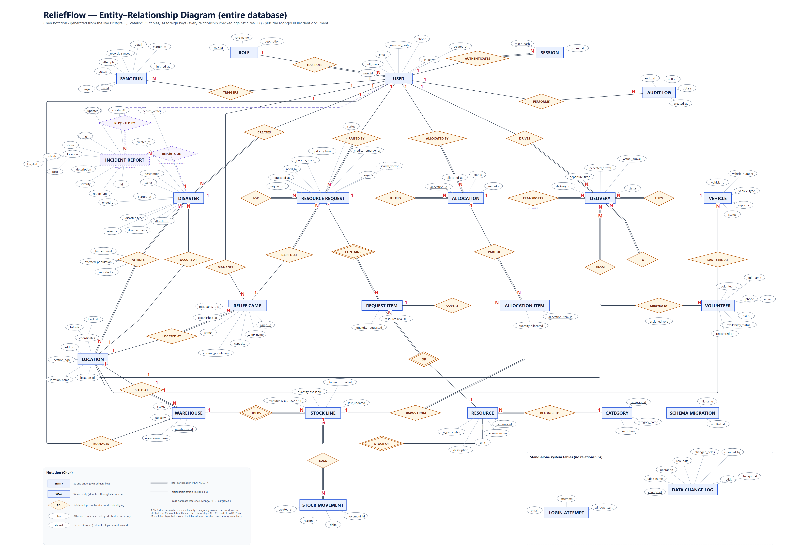

Editable source: `docs/viva/ReliefFlow-ER-Diagram.drawio`.

### 7.2 Relational schema

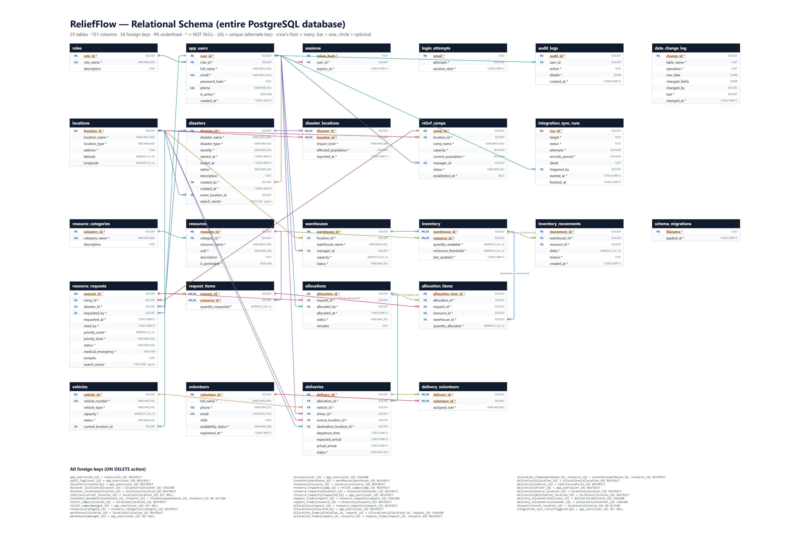

Editable source: `docs/viva/ReliefFlow-Relational-Schema.drawio`.

### 7.3 Entities, keys, relationships and constraints (summary)

{{COUNTS}}

| Relationship (ER) | Cardinality | Implemented as |
|---|---|---|
| Camp RAISES Request | 1 : N, request total | `resource_requests.camp_id NOT NULL` FK |
| Disaster AFFECTS Location | M : N with attributes | table `disaster_locations` (PK disaster_id, location_id) |
| Request CONTAINS Request Item | identifying, weak entity | `request_items` PK (request_id, resource_id), ON DELETE CASCADE |
| Warehouse HOLDS Stock Line OF Resource | identifying, weak entity | `inventory` PK (warehouse_id, resource_id) |
| Allocation Item COVERS Request Item / DRAWS FROM Stock Line | N : 1 each | **composite FKs** (request_id, resource_id) and (warehouse_id, resource_id) |
| Delivery TRANSPORTS Allocation | N : 1, ≤ 1 active | FK + partial unique index `WHERE status <> 'CANCELLED'` |
| Delivery CREWED BY Volunteer | M : N | table `delivery_volunteers` |

Constraint highlights:
* `CHECK (quantity_available >= 0)` on stock;
* `CHECK (current_population <= capacity)`, and status / occupancy consistency, on camps;
* `CHECK (ended_at >= started_at)` on disasters;
* `need_by >= requested_at` on requests;
* enumerated CHECKs on every status column;
* e-mail and phone format CHECKs;
* UNIQUE on e-mail, vehicle number and category name;
* referential actions chosen per relationship: **RESTRICT** protects history, **CASCADE** for owned detail rows, **SET NULL** for optional managers.

### 7.4 ER-to-relational mapping

| ER element | Rule applied |
|---|---|
| Strong entity | Table with a surrogate identity PK (`GENERATED ALWAYS AS IDENTITY`) |
| Weak entity | Table whose PK includes the owner's PK |
| 1 : N | FK on the N side; NOT NULL when participation is total |
| M : N | Junction table, PK = both FKs, relationship attributes stored there |
| Composite attribute | Flattened (coordinates → latitude, longitude) |
| Derived attribute | Not stored (occupancy %) or a GENERATED column (search_vector) |
| Multivalued attribute | Array in MongoDB (`tags`, `updates`) |

### 7.5 NoSQL data model (MongoDB)

Collection **`incident_reports`**, one document per field report:

```json
{ "_id": ObjectId, "disasterId": 11, "reportedBy": 7, "reporterName": "…",
  "reportType": "MEDICAL", "severity": "CRITICAL", "status": "OPEN",
  "description": "Cluster of acute diarrhoea among children…",
  "location": { "label": "Aluva Government School Camp", "latitude": 10.1, "longitude": 76.35 },
  "tags": ["waterborne", "children"],
  "updates": [ { "note": "Medical team dispatched", "by": 6, "byName": "…", "at": ISODate } ],
  "createdAt": ISODate, "updatedAt": ISODate }
```

The model:
* **Embedded:** `location` and `updates`, read together with the report.
* **Referenced:** `disasterId` and `reportedBy`, validated against PostgreSQL before every insert.
* **Indexes:** {disasterId, createdAt}, {reportType, severity}, {status, createdAt}, and a weighted text index (description × 5, tags × 3, location × 1).
* **Validation:** `$jsonSchema` with required fields, enums and lengths.

### 7.6 Vector data model (pgvector)

| Question (requirement §8) | ReliefFlow answer |
|---|---|
| What data becomes embeddings? | Incident descriptions with their tags and location, resource-request summaries (camp, items, remarks) and disaster descriptions: 44 documents in the demo data. |
| Which model? | **sentence-transformers all-MiniLM-L6-v2**, run locally through Transformers.js / ONNX Runtime: mean pooling, L2-normalised, **384 dimensions**. No API key is needed and no text leaves the machine. Voyage AI or OpenAI is used instead if a key is configured; a labelled lexical fallback covers offline use. |
| How are vectors stored? | Table `document_vectors(source, source_id, provider, dims, title, content, metadata JSONB, embedding vector, synced_at)`, PK (source, source_id, provider), in a separate PostgreSQL + pgvector database. |
| Index | Partial expression **HNSW** index `((embedding::vector(384)) vector_cosine_ops) WHERE provider = 'minilm'` |
| Similarity metric | **Cosine similarity** = 1 − cosine distance (`<=>` operator). |
| Retrieval strategy | The query text is embedded with the same model, then `ORDER BY embedding <=> query LIMIT k` (k-nearest neighbours), optionally filtered by source. Results are shown beside MongoDB keyword results. Synchronisation is explicit (Re-embed button) and recorded in `integration_sync_runs`. |

## 8. Data dictionary

The data dictionary is stored **inside PostgreSQL** as table and column comments (`COMMENT ON`, migration 008) and is read straight from the catalog.

{{DICTIONARY}}

## 9. SQL implementation (DDL)

Schema files run in order: `001_schema.sql` (base schema) and the incremental migrations `005` to `008`, each applied once and recorded in `schema_migrations`. Representative DDL:

```sql
-- CREATE with keys and constraints
CREATE TABLE inventory (
  warehouse_id BIGINT NOT NULL REFERENCES warehouses(warehouse_id) ON DELETE RESTRICT,
  resource_id  BIGINT NOT NULL REFERENCES resources(resource_id)  ON DELETE RESTRICT,
  quantity_available NUMERIC(14,3) NOT NULL DEFAULT 0 CHECK (quantity_available >= 0),
  minimum_threshold  NUMERIC(14,3) NOT NULL DEFAULT 0 CHECK (minimum_threshold >= 0),
  last_updated TIMESTAMPTZ NOT NULL DEFAULT NOW(),
  PRIMARY KEY (warehouse_id, resource_id)                       -- composite key
);
CREATE TABLE allocation_items (
  allocation_item_id BIGINT GENERATED ALWAYS AS IDENTITY PRIMARY KEY,
  allocation_id BIGINT NOT NULL, request_id BIGINT NOT NULL,
  resource_id BIGINT NOT NULL, warehouse_id BIGINT NOT NULL,
  quantity_allocated NUMERIC(14,3) NOT NULL CHECK (quantity_allocated > 0),
  FOREIGN KEY (allocation_id, request_id) REFERENCES allocations(allocation_id, request_id) ON DELETE CASCADE,
  FOREIGN KEY (request_id, resource_id)   REFERENCES request_items(request_id, resource_id) ON DELETE RESTRICT,
  FOREIGN KEY (warehouse_id, resource_id) REFERENCES inventory(warehouse_id, resource_id) ON DELETE RESTRICT
);

-- ALTER: add columns and constraints without touching existing rows
ALTER TABLE disasters ADD COLUMN IF NOT EXISTS event_location_id BIGINT REFERENCES locations;
ALTER TABLE disasters ADD COLUMN IF NOT EXISTS search_vector tsvector GENERATED ALWAYS AS (
  setweight(to_tsvector('english', coalesce(disaster_name,'')), 'A') ||
  setweight(to_tsvector('english', coalesce(description,'')), 'C')) STORED;
ALTER TABLE relief_camps ADD CONSTRAINT camp_status_occupancy CHECK (
  (status='CLOSED' AND current_population=0) OR (status='FULL' AND current_population=capacity)
  OR (status='OPEN' AND current_population<capacity)) NOT VALID;

-- INDEXES: B-tree, composite, partial unique, GIN full-text, trigram
CREATE INDEX idx_requests_status_priority ON resource_requests(status, priority_level, need_by);
CREATE UNIQUE INDEX uq_active_delivery_vehicle ON deliveries(vehicle_id) WHERE status IN ('PLANNED','IN_TRANSIT','DELAYED');
CREATE INDEX idx_disasters_fts ON disasters USING gin (search_vector);
CREATE INDEX idx_locations_name_trgm ON locations USING gin (location_name gin_trgm_ops);

-- VIEW
CREATE OR REPLACE VIEW v_low_stock AS
SELECT w.warehouse_id, w.warehouse_name, r.resource_id, r.resource_name, i.quantity_available, i.minimum_threshold, r.unit
FROM inventory i JOIN warehouses w ON w.warehouse_id = i.warehouse_id JOIN resources r ON r.resource_id = i.resource_id
WHERE i.quantity_available <= i.minimum_threshold;

-- DROP (safe, idempotent re-creation of triggers and constraints in migrations)
DROP TRIGGER IF EXISTS delivery_status_guard ON deliveries;
ALTER TABLE volunteers DROP CONSTRAINT IF EXISTS volunteers_phone_format;
```

The full scripts are in `db/postgres/` (about 600 lines of DDL). The lab additionally demonstrates CREATE → ALTER → DROP and TRUNCATE live (section 10).

## 10. Database operations (DML)

The application performs every DML operation through parameterised SQL in API transactions. For example, creating a request inserts the header and all its lines in one transaction:

```sql
INSERT INTO resource_requests(camp_id, disaster_id, requested_by, need_by, priority_score, priority_level, medical_emergency, remarks)
VALUES ($1,$2,$3,$4,$5,$6,$7,$8) RETURNING request_id;
INSERT INTO request_items(request_id, resource_id, quantity_requested)
SELECT $1, x.resource_id, x.quantity FROM unnest($2::bigint[], $3::numeric[]) AS x(resource_id, quantity);
-- camp admission without lost updates (atomic relative UPDATE)
UPDATE relief_camps SET current_population = current_population + $2,
       status = CASE WHEN current_population + $2 >= capacity THEN 'FULL' ELSE 'OPEN' END
 WHERE camp_id = $1 AND status <> 'CLOSED' AND current_population + $2 BETWEEN 0 AND capacity;
-- reference data deletion (blocked by FK RESTRICT when still in use)
DELETE FROM resource_categories WHERE category_id = $1;
```

Executed examples from the lab sandbox (real outputs, rolled back):

{{DML}}

## 11. Important queries (with live results)

{{QUERIES}}

## 12. Advanced database features

At least four SQL concepts and one NoSQL/vector concept are required; ReliefFlow implements all of the following.

| # | Feature | Where / how |
|---|---|---|
| 1 | **Transactions** | Every multi-step operation runs in one transaction (`transaction()` in `src/lib/api.ts`). Locks are taken in a fixed order (request → lines → stock), SAVEPOINT is used in the demos, and the lab demonstrates ACID and isolation anomalies with two real sessions. |
| 2 | **Views** | 5 views: `v_low_stock`, `v_request_fulfillment`, `v_warehouse_inventory_summary`, `v_resource_demand`, `v_disaster_response_summary`. |
| 3 | **Stored procedures / functions** | Procedure `refresh_request_status()` (`CALL`) is the single source of truth for request status. Functions: `resource_availability()`, `request_fulfillment_pct()`, `remaining_request_quantity()`, `operational_summary()` (set-returning) and `lock_request_parents()` (SECURITY DEFINER). |
| 4 | **Triggers** | 16 attachments of 8 trigger functions: allocation validation, automatic stock deduction, stock-movement history, allocation and delivery state machines, vehicle-maintenance guard, duplicate-event guard, field-level audit log. |
| 5 | **Indexing** | 65 indexes: FK indexes, composite, partial unique (one active delivery per vehicle, driver and allocation), GIN full-text, trigram, HNSW vector. Measured with EXPLAIN ANALYZE in the lab. |
| 6 | **Full-text search** | Generated `tsvector` columns with GIN indexes, `websearch_to_tsquery` and `ts_rank`; MongoDB text index with textScore. |
| 7 | **Row-level security and DB roles** | `rf_admin`, `rf_coordinator`, `rf_field_officer` and `rf_driver`, with table- and column-level GRANTs and 4 RLS policies; the API runs every transaction as the user's role. |
| 8 | **NoSQL aggregation** | `$facet`, `$group`, `$unwind` and `$lookup` pipelines for incident analytics. |
| 9 | **Vector similarity search** | MiniLM embeddings in pgvector, cosine similarity, HNSW index. |
| 10 | **Concurrency control** | Row locks (`FOR UPDATE` / `FOR SHARE`), optimistic locking with `xmin`, deadlock prevention through lock ordering; 9 lab scenarios. |

## 13. NoSQL implementation (MongoDB commands)

`db/mongodb/incident_commands.mongosh.js` contains the same operations the application performs. It runs on a scratch database:

```js
db.createCollection("incident_reports", { validator: { $jsonSchema: { bsonType: "object",
  required: ["disasterId","reportedBy","reportType","description","location","severity","createdAt","updatedAt"],
  properties: { reportType: { enum: ["DAMAGE","MEDICAL","SUPPLY","SAFETY","GENERAL"] },
                severity:   { enum: ["LOW","MODERATE","HIGH","CRITICAL"] },
                description:{ bsonType: "string", minLength: 10 } /* … */ } } } });
db.incident_reports.createIndex({ disasterId: 1, createdAt: -1 });
db.incident_reports.createIndex({ description: "text", tags: "text", "location.label": "text" },
                                { weights: { description: 5, tags: 3, "location.label": 1 } });
db.incident_reports.insertOne({ disasterId: 11, reportType: "MEDICAL", severity: "CRITICAL", /* … */ });
db.incident_reports.find({ $text: { $search: "children water" } }, { score: { $meta: "textScore" } })
                   .sort({ score: { $meta: "textScore" } });
db.incident_reports.updateOne({ _id: id }, { $set: { status: "MONITORING" },
                                            $push: { updates: { note: "Medical team dispatched", by: 6, at: new Date() } } });
db.incident_reports.aggregate([{ $facet: { bySeverity: [{ $group: { _id: "$severity", n: { $sum: 1 } } }],
                                           topTags: [{ $unwind: "$tags" }, { $group: { _id: "$tags", n: { $sum: 1 } } }] } }]);
db.incident_reports.aggregate([{ $group: { _id: "$disasterId", n: { $sum: 1 } } },
                               { $lookup: { from: "disasters", localField: "_id", foreignField: "_id", as: "d" } }]);
db.incident_reports.deleteOne({ _id: id });
```

Output of a real run:

```text
{{MONGO_OUTPUT}}
```

## 14. Vector database implementation (pgvector commands)

`db/vector/pgvector_commands.sql`:

```sql
CREATE EXTENSION IF NOT EXISTS vector;
CREATE TABLE vector_demo.docs (id SERIAL PRIMARY KEY, title TEXT, embedding vector(3));
CREATE INDEX docs_hnsw ON vector_demo.docs USING hnsw (embedding vector_cosine_ops);
SELECT title, 1 - (embedding <=> '[0.85,0.2,0.05]') AS cosine_similarity
FROM vector_demo.docs ORDER BY embedding <=> '[0.85,0.2,0.05]' LIMIT 3;
-- the real table, partial HNSW index per embedding model
CREATE INDEX dv_hnsw_minilm ON document_vectors USING hnsw ((embedding::vector(384)) vector_cosine_ops) WHERE provider = 'minilm';
```

Output of a real run:

```text
{{VECTOR_OUTPUT}}
```

Semantic search results from the application (no API key; local model):

{{SEMANTIC}}

These results are retrieved **by meaning**: "kids getting ill from dirty water" ranks the diarrhoea report first although the two texts share no words.

## 15. Database–application integration

1. A React page calls `fetch('/api/requests', { method: 'POST', body: JSON })`.
2. `endpoint()` assigns a request id, logs the call and maps errors to safe status codes (400, 401, 403, 404, 409, 429, 503).
3. `actor()` reads the httpOnly session cookie, hashes it (SHA-256), looks it up in `sessions ⋈ app_users ⋈ roles`, checks the required role and checks that write requests come from the same origin.
4. A strict Zod schema validates the body (types, ranges, unknown fields rejected).
5. `transaction()` runs `BEGIN; SET LOCAL lock_timeout; SET LOCAL ROLE rf_<role>; set_config('reliefflow.user_id', …)`, then the parameterised SQL. Triggers and constraints run inside it, and it ends with COMMIT, or ROLLBACK on any error.
6. The JSON response is returned; writes also invalidate the Redis dashboard cache.

All credentials come from environment variables; `.env` and `.env.local` are git-ignored.

## 16. Authentication and authorisation

| Layer | Mechanism |
|---|---|
| Authentication (backend) | bcrypt password hashes (cost 12). A random 256-bit session token is sent in an **httpOnly, SameSite=Strict** cookie, and only its SHA-256 hash is stored. Sessions expire after 8 h. Logins are throttled to 10 attempts per 15 minutes, with a constant-time dummy comparison. Sessions are revoked on logout, role change, deactivation and password reset. |
| Roles (4) | ADMIN, RELIEF_COORDINATOR, FIELD_OFFICER, DRIVER, stored in table `roles`. |
| API authorisation | Each route declares its allowed roles; drivers can act only on their own deliveries. |
| **Database authorisation** | PostgreSQL roles `rf_admin`, `rf_coordinator`, `rf_field_officer` and `rf_driver`. **Table and column GRANTs** mean, for example, that only rf_admin can read `password_hash` and field officers may update only `current_population` and `status` of camps. **Row-level security** on `deliveries` lets a driver see and update only their own rows. History tables are writable only through SECURITY DEFINER triggers. |
| CSRF | SameSite cookies, Origin / Sec-Fetch-Site checks, JSON content type required. |

Evidence (queries executed against the live database):

{{RLS}}

## 17. Data validation and integrity

Validation is implemented **at the database level** and also at the API boundary:
* **Database:** NOT NULL, UNIQUE, CHECK (ranges, enumerations, formats, cross-column rules), and FOREIGN KEYs with chosen referential actions.
* **Triggers:** stock and demand validation, state machines, duplicate detection, immutable allocation history.
* **Partial unique indexes:** no double booking.
* **Optimistic concurrency:** `xmin` row versions and `expected_quantity` checks.
* **API:** strict Zod schemas give clear messages before the database is touched.

The integration tests prove that direct SQL which bypasses the API is still rejected (negative stock, occupancy over capacity, invalid delivery transitions, editing allocation history).

## 18. Next.js project tree

```text
{{TREE}}
```

## 19. Application screenshots

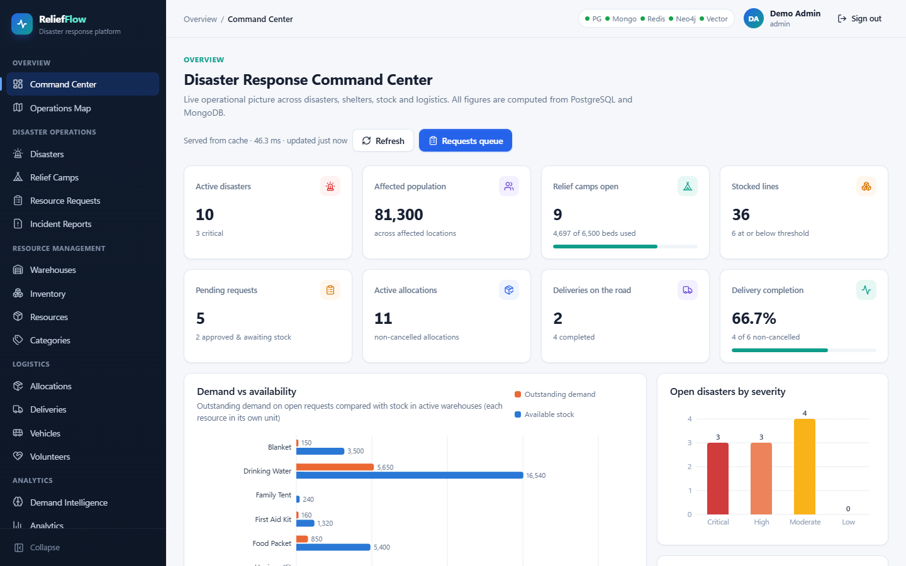

*Command Center: live KPIs, demand vs availability, severity, trends and shortages.*

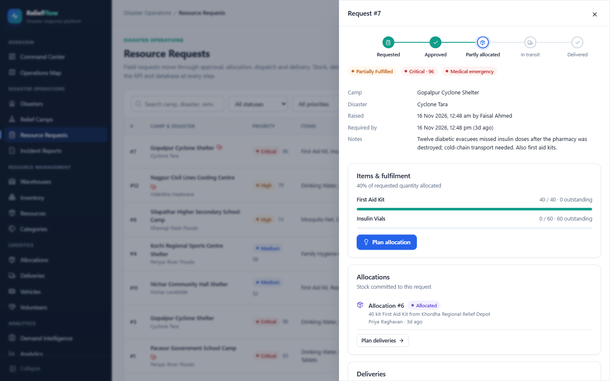

*Request detail: pipeline stepper, fulfilment progress, approval actions.*

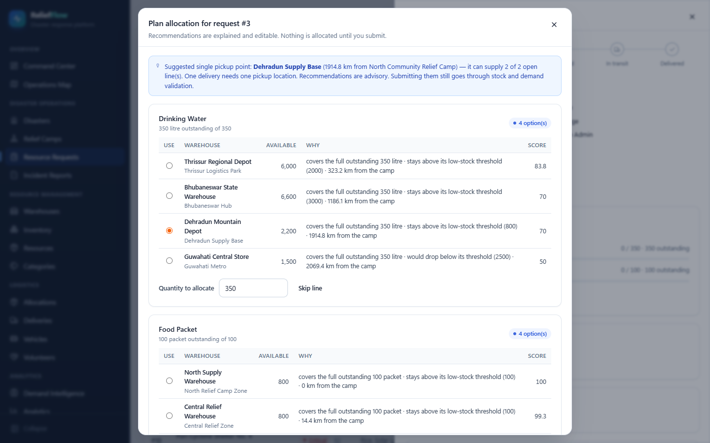

*Explainable allocation recommendations (distance, threshold, coverage).*

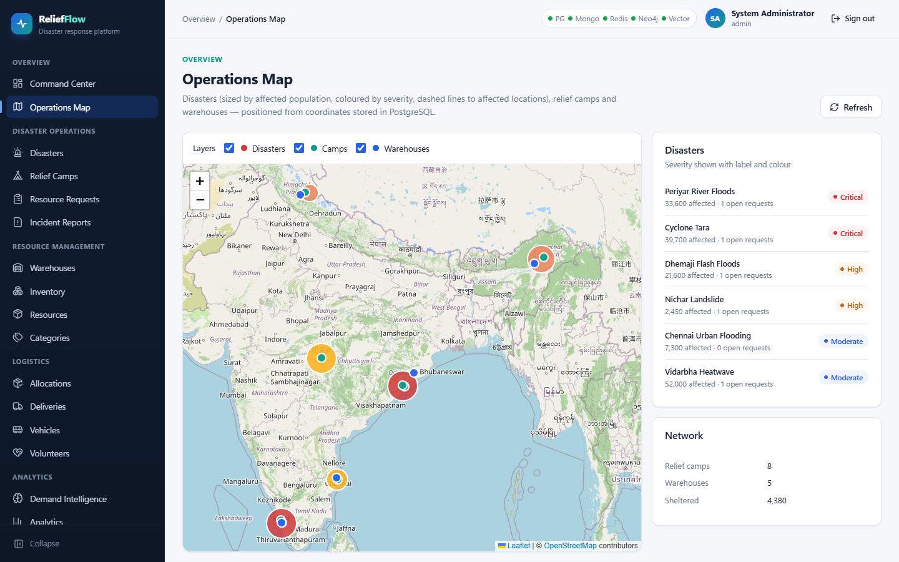

*Operations map from stored coordinates.*

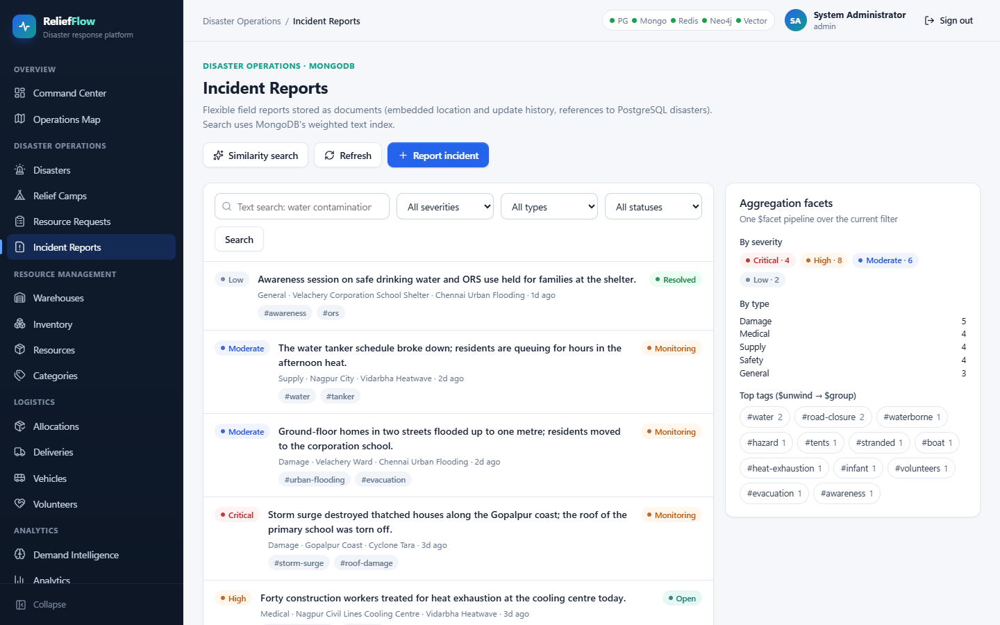

*MongoDB incident reports with text search and aggregation facets.*

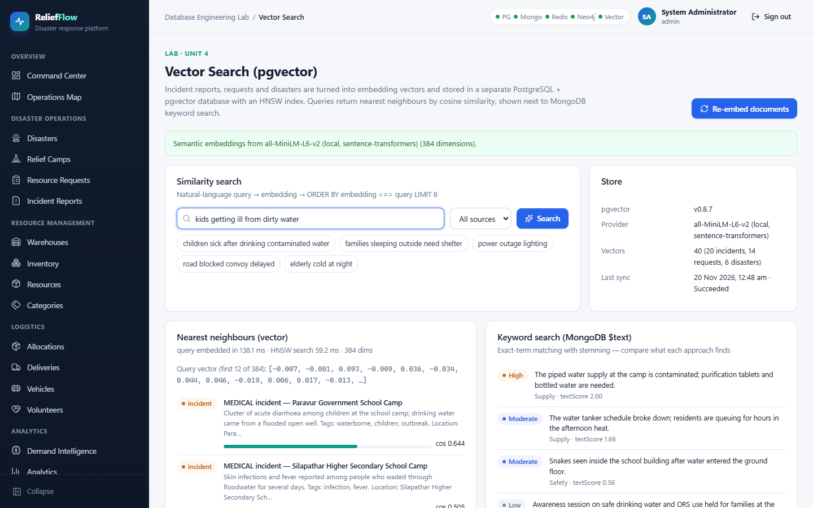

*Semantic search (MiniLM + pgvector) next to keyword search.*

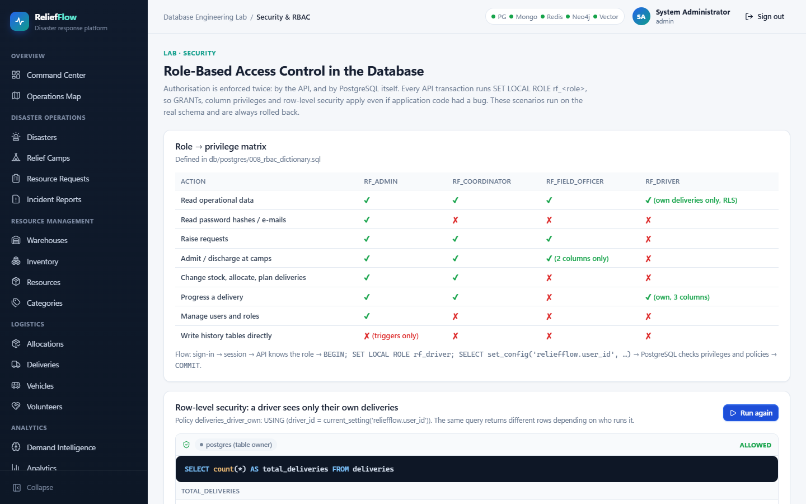

*Database-level RBAC: PostgreSQL denies and filters by role.*

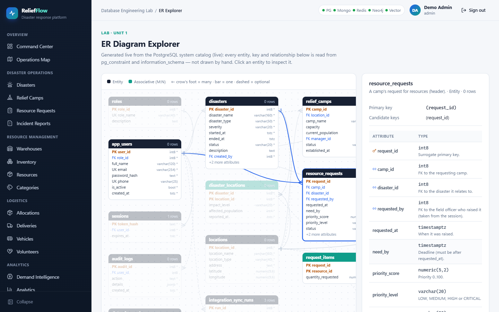

*Live ER explorer with the in-database data dictionary.*

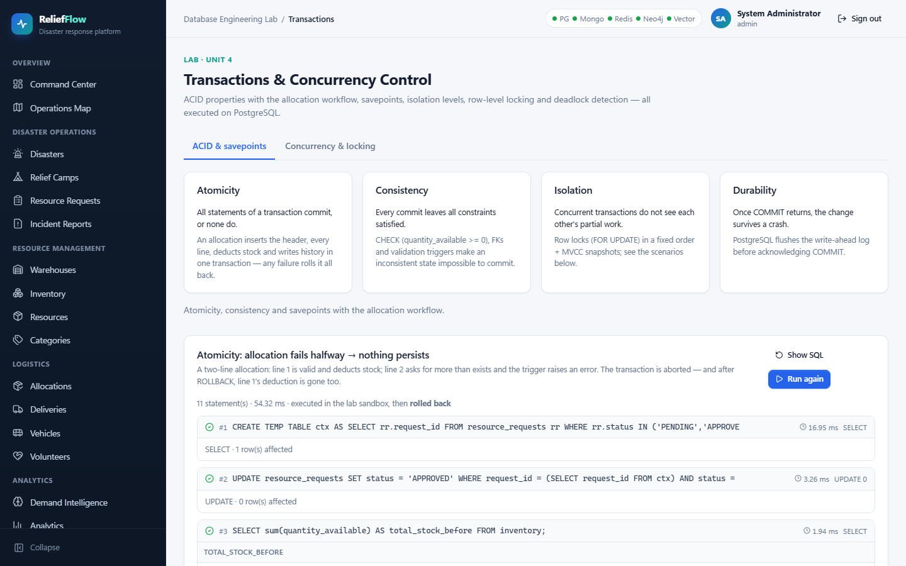

*Two real sessions: row lock, wait, and CHECK-protected stock.*

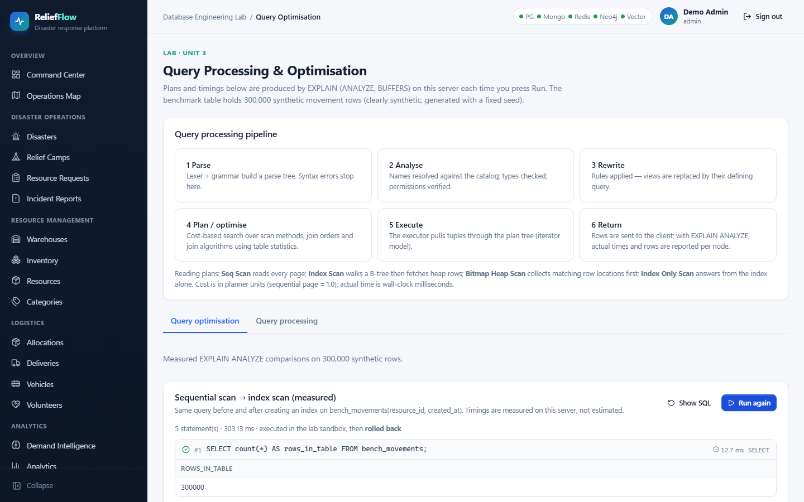

*EXPLAIN ANALYZE plan trees with measured timings.*

### Code screenshots

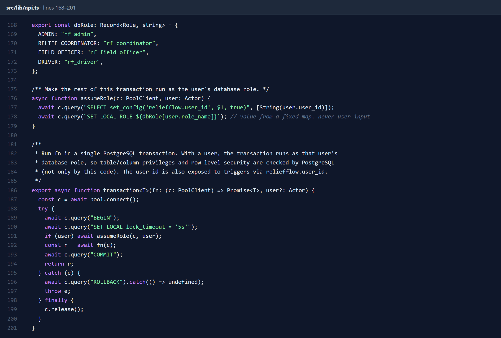

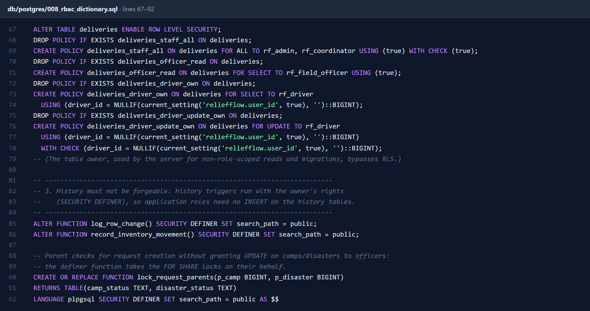

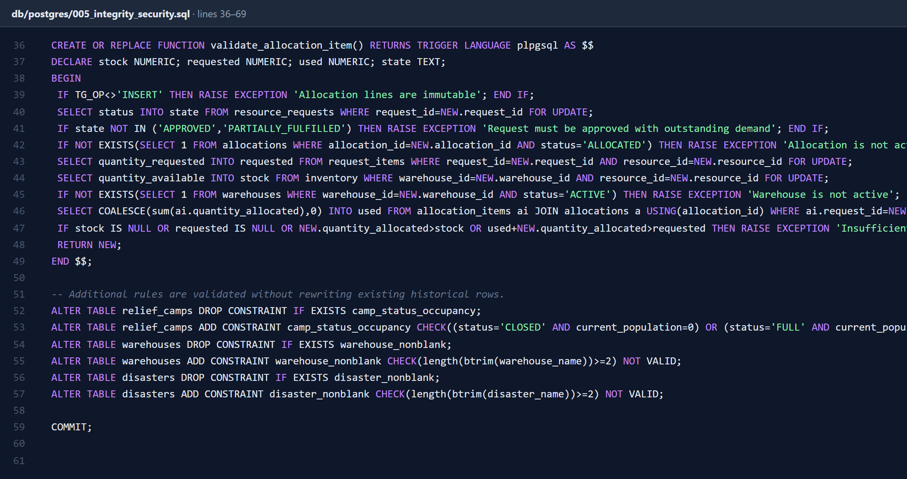

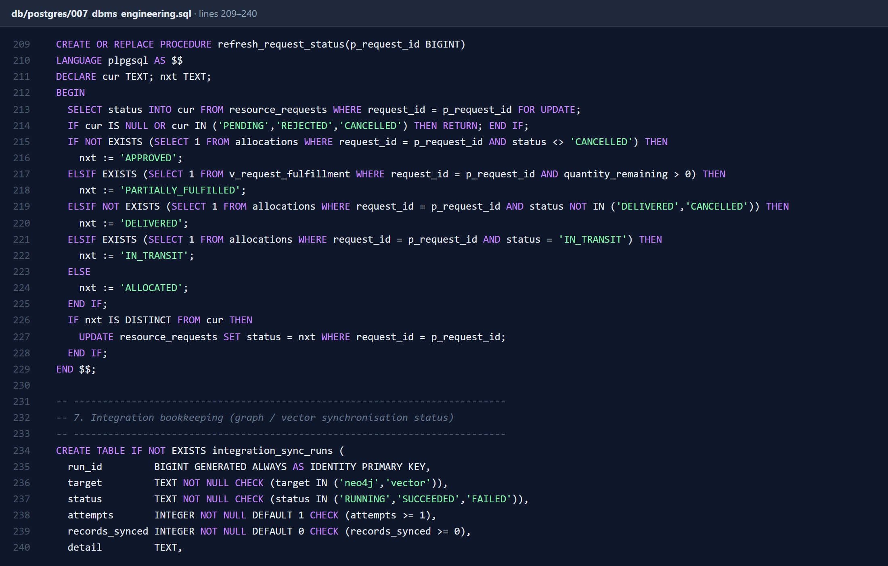

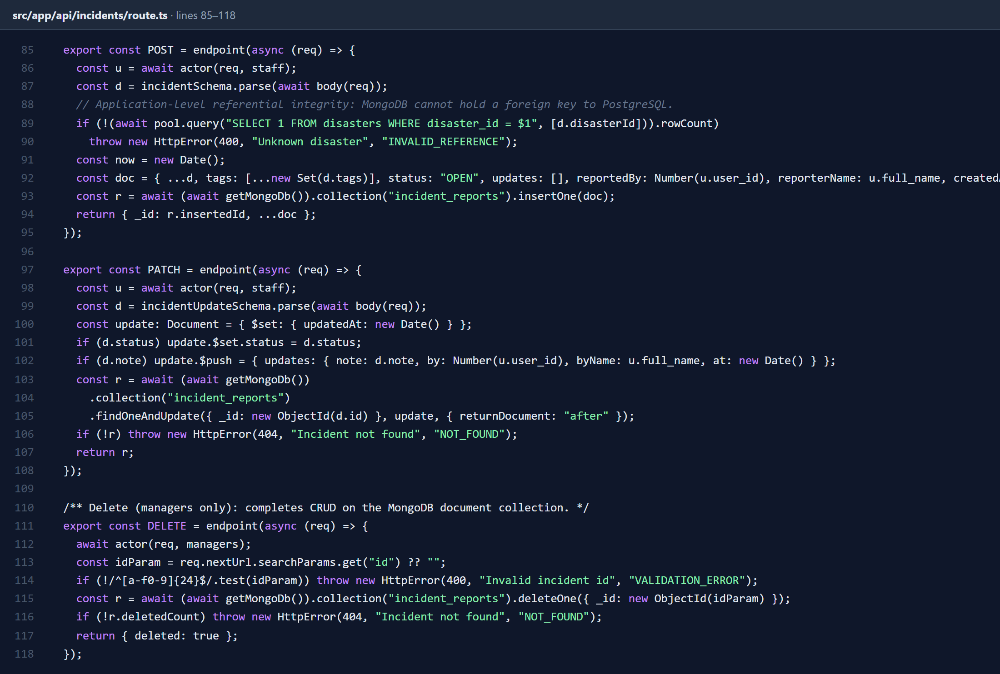

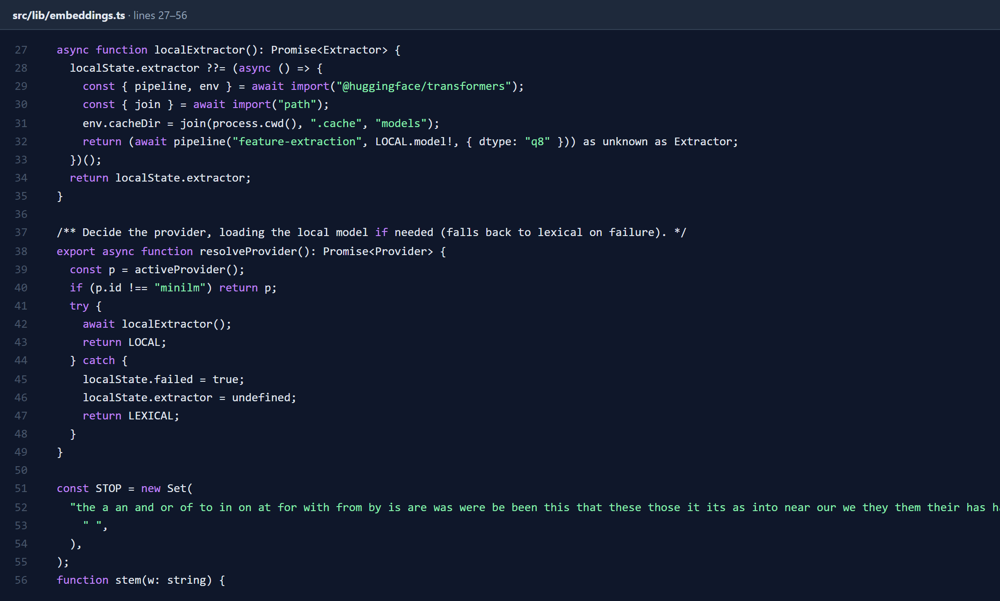

## 20. Testing results

| Suite | Command | Result |
|---|---|---|
| Unit | `npm test` | **{{UNIT}}** passed (validation, state machines, normalisation engine, SQL guard, origin check, embeddings) |
| Integration (end-to-end) | `npm run test:integration` | **{{INTEGRATION}}** checks passed on fresh PostgreSQL and MongoDB databases, including a Playwright browser run over every screen |
| Live services | `npm run test:services` | **{{SERVICES}}** passed (Redis, Neo4j sync, Neo4j failure and retry, pgvector) |
| Static checks | `npm run lint`, `npx tsc --noEmit`, `npm run build` | clean, clean, successful |

Selected test cases:
* allocation exceeding stock or demand is rejected (409), and a multi-line allocation with one bad line rolls back completely;
* two concurrent allocations of the same stock: exactly one succeeds;
* 12 concurrent camp admissions are all counted (no lost update);
* concurrent double booking of one vehicle: exactly one succeeds;
* cancelling an allocation twice, or after dispatch, is rejected, and stock is restored exactly once;
* invalid delivery transitions are rejected by the database trigger;
* a deactivated user's session is rejected, and role changes revoke sessions;
* malformed JSON, wrong content type, unknown fields and invalid ids return 400;
* cross-site requests return 403;
* **RLS**: as `rf_driver`, only own deliveries are visible and updates to others' rows affect 0 rows; reading `password_hash` is denied;
* MongoDB create, read, update and delete (delete limited to managers);
* invalid documents are rejected by the validator;
* lab statements are always rolled back, and the playground rejects multi-statement input and dangerous functions.

## 21. Evaluation rubric — completion status

| Criterion | Marks | Status | Evidence |
|---|---|---|---|
| ER diagram | 2 | ✅ Complete | §7.1, `docs/viva/ReliefFlow-ER-Diagram.drawio` |
| Relational schema with keys, relationships and constraints | 3 | ✅ Complete | §7.2–7.4, data dictionary §8 |
| SQL implementation: DDL with constraints | 4 | ✅ Complete | §9, `db/postgres/001,005–008` |
| NoSQL / vector database creation | 4 | ✅ Complete | §7.5–7.6, §13–14 |
| Technology justification | 1 | ✅ Complete | §5 |
| DML operations | 4 | ✅ Complete | §10 |
| Nested / correlated / recursive queries and joins | 4 | ✅ Complete | §11 |
| Advanced SQL (procedure / function, trigger, CTE) | 6 | ✅ Complete | §11–12 |
| NoSQL / vector feature, CRUD | 7 | ✅ Complete | §13–14, Incidents page (create, read, update, delete), semantic search |
| Next.js interface | 3 | ✅ Complete | §19 |
| Backend / API and database integration | 2 | ✅ Complete | §15 |
| Authentication (front end) + ≥ 2 roles + RBAC in database | 4 | ✅ Complete | §16 (4 roles, PostgreSQL GRANTs and RLS) |
| Documentation, Git / GitHub | 2 | ✅ Complete | this report, README, GitHub repository |
| Originality, individual contribution, modification / viva | 4 | Presented live | §22 and the team explanation document |

## 22. Team contribution

| Area | SUJAL Y | SUJAN H |
|---|---|---|
| Database | PostgreSQL design: ER model, relational schema, DDL, constraints, indexes, views, triggers, functions and procedure, transactions and concurrency, DB-level RBAC with RLS, data dictionary | MongoDB data model, validation, indexes, aggregation; pgvector embeddings and semantic search; Redis cache; Neo4j graph projection |
| Application | Core API: authentication and sessions, requests, allocations, deliveries, camps, inventory, user administration; SQL, optimisation, normalisation, transactions and security lab pages | Next.js interface: design system, dashboard, map, management screens, incidents, intelligence, analytics; NoSQL, key-value, graph and vector lab pages |
| Quality | Database and integration tests | Browser (Playwright) tests, documentation, diagrams |

Both members contribute to database and application work, as required. Details are in *ReliefFlow-Team-Explanation.pdf*.

## 23. Git and GitHub

The source is maintained at **github.com/Aqual456/DBSM-project**, with a README covering setup and execution. Secrets (`.env`, `.env.local`), database backups and build output are excluded by `.gitignore`.

## 24. Conclusion

ReliefFlow shows that the choice of database follows the data:
* **relational** for consistent, related, concurrently updated operations;
* **document** for evolving field reports;
* **vector** for meaning-based retrieval.

It enforces correctness and security *inside* the databases (constraints, triggers, procedures, row locks, roles and row-level security), so the application cannot violate them even by mistake.

Future work:
* real-time vehicle tracking;
* SMS alerts to camps;
* read replicas for analytics;
* fine-tuned embeddings for regional languages.

## Appendix A — How to run

```bash
docker compose up -d
docker compose --profile optional up -d --no-deps redis neo4j vectordb
npm ci
npm run db:migrate && npm run mongo:indexes && npm run db:demo && npm run lab:setup
npm run dev          # http://localhost:3000
npm test && npm run build && npm run test:integration && npm run test:services
```
