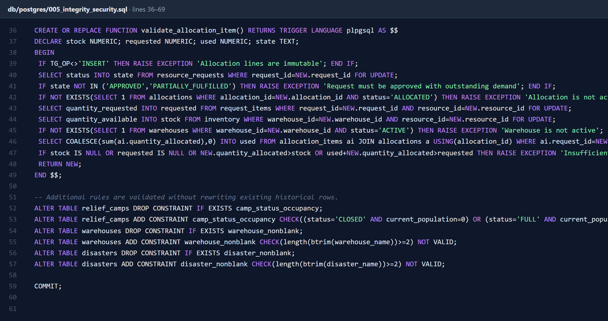
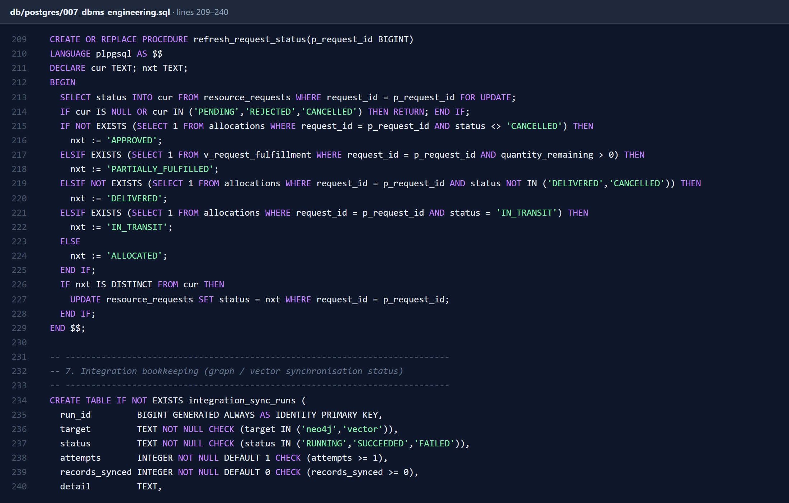
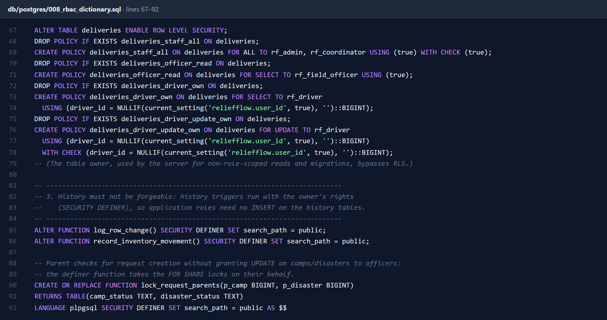
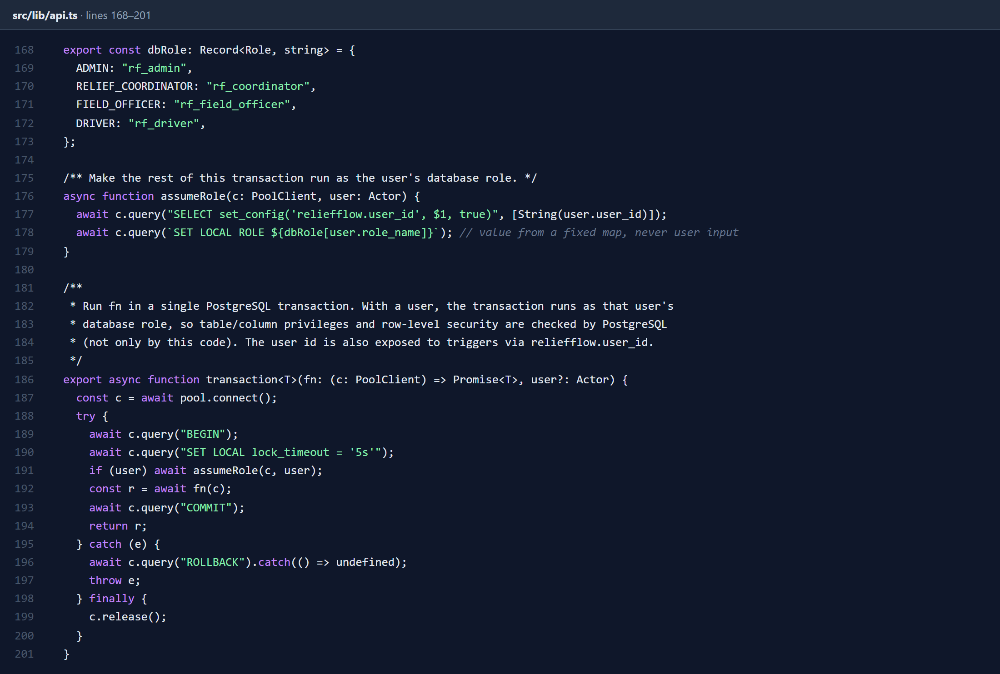
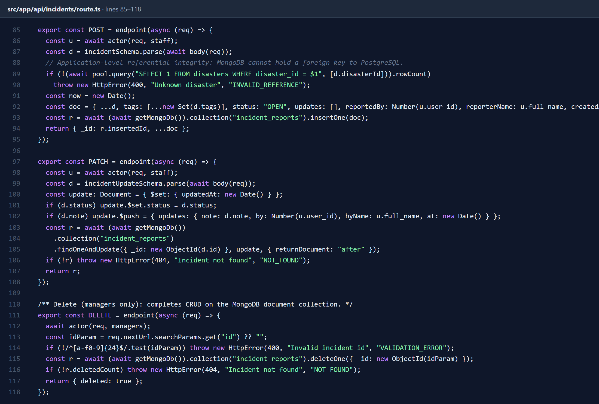
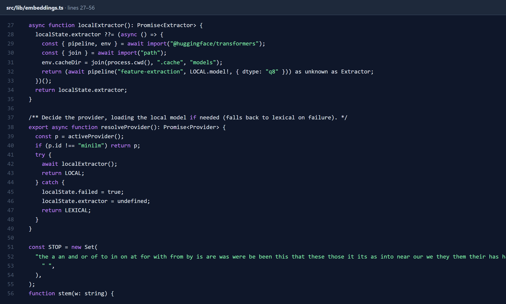
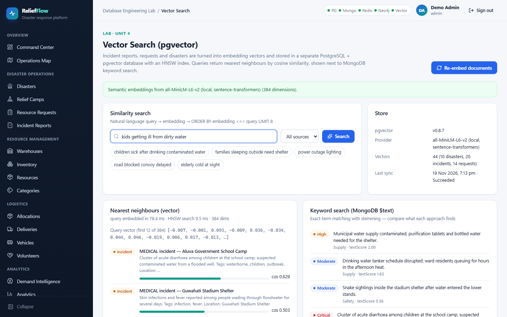

<div class="titlepage">
<div class="tp-uni">PES University</div>
<div class="tp-dept">Department of Computer Science and Engineering · DBMS Experiential Learning, Level 3</div>
<div class="tp-title">ReliefFlow</div>
<div class="tp-subtitle">Team Explanation &amp; Presentation Guide<br/>What each member owns, what it is, why it was built this way, how it works, and how to demo and defend it</div>
<table class="tp-team"><thead><tr><th>Member</th><th>SRN</th><th>Ownership area</th></tr></thead><tbody>
<tr><td><span class="owner sujal">SUJAL Y</span></td><td>____________________</td><td>Relational database (PostgreSQL), transactions, security, core workflow APIs, SQL lab</td></tr>
<tr><td><span class="owner sujan">SUJAN H</span></td><td>____________________</td><td>MongoDB, vector search, Redis, Neo4j, Next.js interface, testing, documentation</td></tr>
</tbody></table>
<div class="tp-meta">Read Part 0 together, then each member studies their own part and the other member's summary (Part 4).</div>
</div>

# ReliefFlow — Team Explanation

## 0. How to use this document

This guide is for presenting and defending the project in the viva. It is split into **ownership areas**:
* **Part 1** belongs to SUJAL Y.
* **Part 2** belongs to SUJAN H.
* **Part 3** covers the parts you both must know.
* **Part 5** is a minute-by-minute presentation script.

Every topic is explained in the same order:
* **What:** what it is.
* **Why:** the reason it was built.
* **How:** how it works, with the real file paths.
* **Demo:** what to show on screen.
* **Viva questions:** what examiners are likely to ask, with model answers.

> **Be honest in the viva.** This split is an *ownership plan*: who is responsible for understanding, presenting and modifying which part. The Git history shows the commits under the account that pushed them. The course asks for individual contributions to be visible in Git, so each of you should make your own commits from your own GitHub account for your area. A small, real improvement or extra test is enough. Examiners often ask you to *modify something live*; Part 6 lists safe modifications for each member to practise.

### The project in one paragraph (memorise this)

ReliefFlow is a disaster-relief coordination platform.
* **Camps** raise requests for resources such as water, food and medicine.
* **Coordinators** approve requests, **allocate** stock from **warehouses** and plan **deliveries** with a vehicle, a driver and volunteers.
* **Drivers** report delivery progress, and **field officers** file **incident reports**.

The design rule: **PostgreSQL** is the source of truth for everything that must stay consistent. **MongoDB** stores free-form incident reports. **pgvector** makes those reports searchable *by meaning*. **Redis** caches the dashboard and **Neo4j** answers relationship questions. All of it sits behind a **Next.js** web application with four roles. The project goes beyond CRUD because correctness is enforced *inside the database*, by constraints, triggers, procedures, row locks and row-level security. A built-in **DBMS lab** demonstrates every syllabus unit live.

### The core workflow (both must be able to draw this)

```
Disaster ──affects──▶ Location ◀── Camp ──raises──▶ Resource Request ──contains──▶ Request Items
                                                    │ PENDING → APPROVED (or REJECTED / CANCELLED)
                                                    ▼
          Warehouse ──holds──▶ Inventory (stock) ──▶ Allocation + Allocation Items   (stock deducted by trigger)
                                                    ▼
                         Vehicle + Driver + Volunteers ──▶ Delivery: PLANNED → IN_TRANSIT → DELIVERED
                                                    ▼
                                    request becomes PARTIALLY_FULFILLED / FULFILLED (stored procedure)
```

### Roles

| Role | Can do | Database role |
|---|---|---|
| ADMIN | Everything, including user management | `rf_admin` |
| RELIEF_COORDINATOR | Approve, allocate, plan deliveries, manage stock and master data | `rf_coordinator` |
| FIELD_OFFICER | Raise requests, admit or discharge people at camps, file incidents | `rf_field_officer` |
| DRIVER | See and progress **only their own** deliveries | `rf_driver` |

Demo logins: `admin@reliefflow.local` (password set by you), coordinator, field-officer and driver demo accounts (see README).

---

## Part 1 — SUJAL Y: Relational database and core backend

<div><span class="owner sujal">SUJAL Y</span> Owns PostgreSQL design and implementation, transactions and concurrency, database security, and the workflow APIs.</div>

### 1.1 Requirements → ER model

**What.** The ER diagram (`docs/viva/ReliefFlow-ER-Diagram.drawio`, Chen notation) shows 24 entities and 34 relationships.

**Why.** The ER model is the conceptual design. It fixes *what* we store and how things relate before any table exists.

**How the entities were found.** Take the nouns of the workflow: disaster, location, camp, warehouse, resource, category, request, request item, inventory line, allocation, allocation item, delivery, vehicle, volunteer, user and role. Add the support entities: sessions, audit log, change log, stock movements and login attempts.

Things to point at on the diagram:
* **Weak entities** (double rectangle):
  * `request_items` exists only inside a request; its key is (request_id, resource_id).
  * `inventory` is a stock line identified by (warehouse_id, resource_id).
* **M:N relationships:**
  * Disaster AFFECTS Location, with relationship attributes such as affected population and severity, giving table `disaster_locations`.
  * Delivery CREWED BY Volunteer, giving `delivery_volunteers`.
* **Participation:** every request *must* belong to a camp (total participation, so the FK is NOT NULL). A warehouse *may* have a manager (partial participation, so the FK is nullable with ON DELETE SET NULL).
* **Derived attribute:** occupancy % = current_population / capacity. It is not stored; it is computed.
* **Multivalued attribute:** incident tags. These live in MongoDB as an array, which is one reason MongoDB fits.

**Viva questions.**
* *Why is request_items a weak entity?*
  * A line such as "50 blankets" means nothing without its request.
  * Its identity is the owner key plus the resource. Deleting the request cascades to its lines.
* *Why surrogate keys?*
  * Natural keys such as camp names change and collide.
  * Identity columns (`GENERATED ALWAYS AS IDENTITY`) are stable, small and fast to join.
  * Natural uniqueness is still enforced, for example UNIQUE on e-mail and on vehicle number.

### 1.2 ER → relational schema (mapping)

**What.** There are 25 tables (`docs/viva/ReliefFlow-Relational-Schema.drawio`).

**How.** Apply the standard mapping rules:

| ER construct | Becomes | Example |
|---|---|---|
| Strong entity | Table + PK | `relief_camps(camp_id PK, …)` |
| Weak entity | PK includes owner key | `request_items PRIMARY KEY (request_id, resource_id)` |
| 1:N | FK on the N side | `resource_requests.camp_id → relief_camps` |
| M:N | Junction table | `disaster_locations(disaster_id, location_id, …)` |
| Composite attribute | Split columns | coordinates → `latitude`, `longitude` |
| Multivalued attribute | Separate table / array | tags → MongoDB array |

**The cleverest part: composite foreign keys.** `allocation_items` has three composite FKs:
* `(allocation_id, request_id) → allocations`;
* `(request_id, resource_id) → request_items`;
* `(warehouse_id, resource_id) → inventory`.

Because `request_id` and `resource_id` are shared, the database itself guarantees two things. You can only allocate a resource **that the request asked for**. You can only draw it **from a warehouse that stocks that resource**. A single-column FK could not express either rule.

**Normalisation.** The schema is in **3NF / BCNF**: every non-key attribute depends on the key, the whole key, and nothing but the key.
* *Example:* the camp's location name is not copied into requests; it is reached by join.
* *Deliberate exception:* `resource_requests.disaster_id` is kept although a camp belongs to a disaster. A camp can serve several disasters over time, so the request records which one it was for. This is a real fact, not redundancy.

The lab page `/lab/normalization` computes closures, candidate keys and a BCNF/3NF decomposition live.

### 1.3 DDL: tables, constraints, indexes, views

**Files.** In `db/postgres/`:
* `001_schema.sql`: base schema.
* `005_integrity_security.sql`: hardening.
* `006_allocation_history.sql`
* `007_dbms_engineering.sql`: views, functions, procedure, full-text search.
* `008_rbac_dictionary.sql`: roles, RLS, data dictionary.

`scripts/migrate.ts` runs each file once and records it in `schema_migrations`. That makes migrations **incremental and repeatable**, so you never drop the database.

**Constraint types to name:**
* `PRIMARY KEY` and `FOREIGN KEY` with actions:
  * **RESTRICT** (you cannot delete a warehouse that still has stock history);
  * **CASCADE** (a request's lines go with it);
  * **SET NULL** (an optional manager).
* `NOT NULL`, `UNIQUE`, `DEFAULT`.
* `CHECK`:
  * `quantity_available >= 0`;
  * `current_population <= capacity`;
  * `ended_at >= started_at`;
  * status enumerations;
  * e-mail format `~* '^[^@\s]+@[^@\s]+\.[^@\s]+$'`;
  * cross-column rule: CRITICAL priority needs score ≥ 50.
* **Partial unique indexes** prevent double booking: only one active delivery per vehicle, per driver and per allocation.
  ```sql
  CREATE UNIQUE INDEX uq_active_delivery_vehicle ON deliveries(vehicle_id) WHERE status IN ('PLANNED','IN_TRANSIT','DELAYED');
  ```
* **NOT VALID** constraints (migration 008) check every *new* row without rejecting old rows. This is how you add a rule to a live database safely.

**Indexes (65).**
* B-tree on every FK, because joins and ON DELETE checks need them.
* Composite `(status, priority_level, need_by)` for the request queue.
* GIN on generated `tsvector` columns for full-text search.
* GIN trigram (`pg_trgm`) for fuzzy name search.
* `/lab/optimization` proves an index turns a sequential scan into an index scan, with measured times.

**Views (5).**
* `v_low_stock`
* `v_request_fulfillment`
* `v_warehouse_inventory_summary`
* `v_resource_demand`
* `v_disaster_response_summary`

Views hide join complexity and give the dashboard a stable interface.

**Viva questions.**
* *Difference between DROP, DELETE and TRUNCATE?*
  * DELETE removes rows (can be filtered, fires triggers, logged per row).
  * TRUNCATE empties the table quickly.
  * DROP removes the object itself.
  * The lab "DDL" demo runs CREATE → ALTER → DROP in a rolled-back transaction.
* *Why CHECK in the database when the API already validates?*
  * The database is the last line of defence.
  * Scripts, other apps or a bug cannot bypass it.
  * The integration tests send raw SQL that bypasses the API, and it is still rejected.

### 1.4 DML and queries

Every API operation is parameterised SQL (`$1, $2, …`). User input never becomes SQL text, which is why **SQL injection is impossible**. Know these query types. The first eight are in the Project Report §11 with live results; the last two are lab demos.

| Type | ReliefFlow example |
|---|---|
| JOIN + GROUP BY + HAVING + ORDER BY | Requests per camp, only camps with more than 1 request |
| Aggregates | Stock by category: COUNT, SUM, AVG, MIN, MAX |
| Nested subquery | Resources whose total stock is below the average |
| Correlated subquery | Camps that requested more than 1,000 units (the inner query refers to the outer camp) |
| NOT EXISTS (relational division) | Warehouses that stock *every* MEDICAL resource |
| Recursive CTE | Days until drinking water runs out: anchor = today's stock, each step subtracts a day's use |
| Window functions | Ranking requests by priority (`RANK() OVER (…)`) |
| Full-text search | Disasters matched with `websearch_to_tsquery` on a GIN-indexed tsvector |
| Set operations (lab) | UNION / INTERSECT / EXCEPT in `/lab/algebra` |
| UPSERT (lab) | `INSERT … ON CONFLICT … DO UPDATE` (report §10) |

**Correlated vs nested.** A *nested* subquery runs once and its result is reused. A *correlated* subquery refers to the outer row, so logically it is re-evaluated for each outer row.

### 1.5 Triggers, functions and the stored procedure

| Object | Type | What it guarantees |
|---|---|---|
| `validate_allocation_item()` | BEFORE trigger on allocation_items | Rejects lines with more than available stock or more than outstanding demand, and makes lines immutable after creation |
| `trg_adjust_inventory` | Trigger | Deducts stock automatically when an allocation line is inserted, and restores it on cancellation |
| `record_inventory_movement()` | AFTER trigger on inventory | Writes every stock change to `inventory_movements` (who, delta, reason) |
| `allocation_status_guard` / `delivery_status_guard` | State-machine triggers | Allow only legal transitions, e.g. DELIVERED cannot go back to PLANNED |
| `delivery_vehicle_guard` | Trigger | A vehicle under maintenance cannot be assigned |
| `prevent_operational_duplicate()` | Trigger | Same disaster or warehouse entered twice (normalised names) → rejected |
| `log_row_change()` | Generic AFTER trigger on many tables | Field-level audit: old and new values in `data_change_log` |
| `refresh_request_status(p_request_id)` | **PROCEDURE** (`CALL`) | Single source of truth that recomputes request status (APPROVED → PARTIALLY_FULFILLED → FULFILLED) from what was actually delivered |
| `resource_availability()`, `request_fulfillment_pct()`, `remaining_request_quantity()` | Functions | Reusable calculations used by views and APIs |
| `operational_summary()` | Set-returning function | Dashboard KPIs in one call |
| `lock_request_parents()` | SECURITY DEFINER function | Lets a field officer lock the camp and disaster rows (FOR SHARE) without having UPDATE rights on them |

**Why triggers instead of application code?**
* Every path that changes stock (API, admin script, lab) goes through the same rule.
* Stock deduction and allocation happen in the **same transaction**, so they succeed or fail together.

**Function vs procedure.**
* A function returns a value and is used inside SQL.
* A procedure is invoked with `CALL` and can manage transactions.
* We use a procedure for the status refresh because it is an *action*, not a value.

### 1.6 Transactions and concurrency (the strongest "wow" topic)

**What.** Every multi-step operation runs in a single transaction: `transaction()` in `src/lib/api.ts`.

**The race we prevent.** Two coordinators allocate the last 100 litres of water at the same time. Without locking, both read "100 available", both allocate, and stock becomes −100 (the lost-update problem).

**How we prevent it.**
1. `SELECT … FOR UPDATE` row-locks the request, then the stock lines, **always in the same order** (request → lines → stock). A consistent lock order means two transactions can never wait for each other in a cycle, so **no deadlock**.
2. The second transaction waits. When the first commits, the second re-reads and sees 0, and the trigger rejects it: **409 Conflict**.
3. `CHECK (quantity_available >= 0)` is the final safety net.
4. **Optimistic concurrency** for edit forms: the form carries the row's `xmin` (PostgreSQL's row version). The UPDATE adds `WHERE xmin = $version`. If someone else edited first, 0 rows match, and the user gets "changed by someone else, reload".
5. Atomic relative updates for camp admissions: `SET current_population = current_population + $n`. The test fires 12 concurrent admissions and all 12 are counted.
6. `lock_timeout = 5s`, so a stuck lock never hangs the app.

**Demo.** Open `/lab/transactions` and run a scenario. Two real database sessions are shown side by side: session B waits on session A's lock, then fails cleanly. Also show the isolation-level demos (dirty read impossible, non-repeatable read under READ COMMITTED vs REPEATABLE READ).

**Viva questions.**
* *What is ACID?*
  * **Atomicity:** the allocation and stock deduction both happen or neither does.
  * **Consistency:** constraints always hold.
  * **Isolation:** concurrent allocations behave as if serial.
  * **Durability:** committed data survives a crash (the WAL).
* *Which isolation level?* READ COMMITTED (the PostgreSQL default) plus explicit row locks where needed. This is cheaper than SERIALIZABLE everywhere, and it is correct because the critical rows are locked.

### 1.7 Database-level security: roles, GRANTs and row-level security

**What (migration 008).** There are four PostgreSQL roles: `rf_admin`, `rf_coordinator`, `rf_field_officer` and `rf_driver`. They are NOLOGIN roles that the application switches into.

**How.** Inside every transaction, the API runs:
```sql
SELECT set_config('reliefflow.user_id', '11', true);   -- who is acting (transaction-local)
SET LOCAL ROLE rf_driver;                              -- with whose privileges
```
From that point, **PostgreSQL itself** checks every statement:
* **Table GRANTs:** a driver cannot `UPDATE inventory` → `permission denied`.
* **Column GRANTs:**
  * only rf_admin may read `app_users.password_hash`;
  * a field officer may update only `current_population` and `status` of camps;
  * a driver may update only `status`, `departure_time` and `actual_arrival` of deliveries.
* **Row-level security** on `deliveries`:
  ```sql
  CREATE POLICY deliveries_driver_own ON deliveries FOR SELECT TO rf_driver
    USING (driver_id = NULLIF(current_setting('reliefflow.user_id', true), '')::BIGINT);
  ```
  The same `SELECT * FROM deliveries` returns 6 rows for the owner and 2 rows for driver 11. Updating another driver's delivery affects 0 rows, so the API answers 404 (it does not even reveal that the row exists).
* **History tables** (`data_change_log`, `inventory_movements`) cannot be written directly by any role. Only the SECURITY DEFINER triggers can write them, so **the audit trail cannot be forged**.

**Why both API checks and database checks?** Defence in depth. Even if a future API route forgets a role check, the database still refuses.

**Demo.** `/lab/security`: run "Row-level security" and "Column privileges". Each step shows ALLOWED or **DENIED by PostgreSQL**, with the real error, and everything is rolled back.

### 1.8 Data dictionary in the database

Every table and all 151 columns have a description, stored with `COMMENT ON` (migration 008). The ER explorer (`/lab/er`) and the report's data dictionary read these descriptions from the catalog (`col_description()`), so the documentation can never drift from the schema.

### 1.9 Core workflow APIs

**Files:**
* `src/app/api/requests/route.ts`: create, approve, reject, cancel.
* `src/app/api/operations/route.ts`: generic CRUD for master data, stock adjustments, allocations, deliveries, users.
* `src/app/api/auth/route.ts`: login and logout.
* `src/lib/api.ts`: `endpoint()`, `actor()`, `transaction()`, `readAs()`.
* `src/lib/validation.ts`: Zod schemas.

**The request pipeline in every route:**
1. `endpoint()` catches errors and maps them to safe HTTP codes: constraint violation → 409, validation → 400.
2. `actor()` authenticates the session and checks the role and the origin (CSRF).
3. A strict Zod schema validates the body; unknown fields are rejected.
4. `transaction(fn, user)` runs the SQL as the user's DB role.

**Authentication.**
* bcrypt hashes (cost 12).
* A random 256-bit session token in an httpOnly, SameSite=Strict cookie; only its SHA-256 hash is stored in `sessions`.
* An 8-hour expiry.
* Login throttling in `login_attempts`, locked FOR UPDATE so parallel guesses are counted correctly.

**The explainable allocation planner** (`/api/intelligence`) scores each warehouse for each request line:
* +50 if it covers the full outstanding quantity;
* +20 if stock stays above its low-stock threshold;
* up to +30 for distance (Haversine formula on stored coordinates).

The UI shows *why* each warehouse was suggested. Recommendations are advisory; submitting still goes through the locks and triggers.

### 1.10 SQL lab pages (SUJAL presents these)

| Page | Shows |
|---|---|
| `/lab/concepts` | DBMS vs file system, schema levels, data independence |
| `/lab/er` | Live ER explorer from the catalog, with descriptions |
| `/lab/algebra` | Relational algebra (σ, π, ⋈, ∪, −, ÷) next to the equivalent SQL, run live |
| `/lab/sql` | Safe SQL playground: one statement, read-only, always rolled back, dangerous functions blocked |
| `/lab/advanced` | Views, functions, procedure, triggers, CTEs, window functions |
| `/lab/optimization` | EXPLAIN ANALYZE: sequential vs index scan, join strategies, 300k-row benchmark table |
| `/lab/normalization` | Functional dependencies → closures → keys → BCNF/3NF decomposition |
| `/lab/transactions` | ACID, isolation anomalies, locks, deadlock, concurrency scenarios |
| `/lab/security` | Roles, column privileges, RLS, audit-forgery prevention |

**Safety.** The lab runs on a **separate sandbox database** (`reliefflow_lab`) with a restricted role `rf_lab`, and every run is rolled back. Demos can never damage real data.









---

## Part 2 — SUJAN H: NoSQL, vector search and the application

<div><span class="owner sujan">SUJAN H</span> Owns MongoDB, pgvector semantic search, Redis, Neo4j, the Next.js interface, testing and documentation.</div>

### 2.1 Why NoSQL at all? (the justification examiners always ask)

| Data | Shape | Best store | Reason |
|---|---|---|---|
| Stock, requests, allocations, deliveries | Highly related, updated concurrently, must never be inconsistent | **PostgreSQL** | ACID, FKs, constraints, locks |
| Incident reports from the field | Free text, optional GPS, variable tags, a growing list of follow-up notes, read as a whole | **MongoDB** | Flexible documents, embedded arrays, text index, aggregation |
| "Find reports similar in meaning" | High-dimensional vectors | **pgvector** | Similarity search with an ANN index |
| Dashboard numbers read every few seconds | Key → value with expiry | **Redis** | In-memory, TTL |
| "How is this disaster connected to that warehouse?" | Multi-hop relationships | **Neo4j** | Graph traversal in Cypher |

**One-line answer:** *we chose each database for the shape of its data, and PostgreSQL stays the single source of truth.*

### 2.2 MongoDB incident reports

**Files.**
* `src/app/api/incidents/route.ts`: CRUD and search.
* `src/lib/mongodb.ts`: client and collection setup.
* `db/mongodb/validator.json` (the $jsonSchema) and `scripts/create-mongo-indexes.ts` (applies it and creates indexes).
* `db/mongodb/incident_commands.mongosh.js`: every command, runnable.

**Document model.**
```json
{ "disasterId": 11, "reportedBy": 7, "reportType": "MEDICAL", "severity": "CRITICAL", "status": "OPEN",
  "description": "Cluster of acute diarrhoea among children…",
  "location": { "label": "Aluva Government School Camp", "latitude": 10.1, "longitude": 76.35 },
  "tags": ["waterborne", "children"],
  "updates": [ { "note": "Medical team dispatched", "by": 6, "at": "…" } ],
  "createdAt": "…", "updatedAt": "…" }
```

**Embed or reference?**
* `location` and `updates` are **embedded**: they belong to one report and are always read with it, so one read returns everything.
* `disasterId` and `reportedBy` are **references** to PostgreSQL. Before inserting, the API checks in PostgreSQL that the disaster exists and is active. That keeps referential integrity across the two stores.

**Validation.** `$jsonSchema` on the collection:
* required fields;
* enums for type, severity and status;
* minimum description length of 10;
* at most 20 tags.

A bad document is rejected by MongoDB itself (error 121, "Document failed validation"). This is database-level validation for NoSQL.

**Indexes:**
* compound `{disasterId: 1, createdAt: -1}` lists a disaster's reports, newest first, without sorting;
* `{reportType, severity}` and `{status, createdAt}` serve the filters;
* a **weighted text index**: description × 5, tags × 3, location × 1. `$text` search returns `textScore`, so a match in the description ranks higher than a match in the location.
* `explain()` shows IXSCAN with the index vs COLLSCAN without it (`/lab/nosql`).

**CRUD in the app (Incidents page):**
* **Create:** a field officer files a report.
* **Read:** list, filter, `$text` search, detail.
* **Update:** `$set` the status and `$push` a note into `updates`.
* **Delete:** managers only; the button asks for confirmation; returns 403 for a field officer.

**Aggregation pipelines:**
* `$facet` computes several summaries in one pass (by severity, by type, by status);
* `$unwind` + `$group` counts the top tags;
* `$lookup` joins with another collection.

**Viva questions.**
* *Why not store incidents in PostgreSQL as JSONB?*
  * We could.
  * MongoDB shows the document-database model natively: schema-on-read with an optional validator, embedded arrays updated with `$push`, text indexes and aggregation pipelines.
  * It also keeps write-heavy field reporting off the transactional database.
* *How do you keep MongoDB and PostgreSQL consistent?*
  * References are validated on write, and the PostgreSQL side is never deleted while referenced (RESTRICT).
  * There is no distributed transaction. We say so honestly; incidents are an append-mostly log, so this is acceptable.

### 2.3 Vector search (pgvector + MiniLM)

**What.** Coordinators search reports *by meaning*. "Kids getting ill from dirty water" finds "Cluster of acute diarrhoea among children… contaminated water" even though the key words differ.

The questions the course requires, with our answers:

| Question | Answer |
|---|---|
| What is embedded? | Incident descriptions (+ tags + location), request summaries (camp, items, remarks) and disaster descriptions: 44 documents |
| Which model? | **all-MiniLM-L6-v2** (sentence-transformers), run **locally** through Transformers.js / ONNX. Output: **384 numbers**, mean-pooled and L2-normalised. No API key, and no data leaves the laptop. |
| Where are vectors stored? | Table `document_vectors` in a separate PostgreSQL + **pgvector** database: `embedding vector`, plus `title`, `content` and `metadata JSONB` |
| Index | **HNSW** (Hierarchical Navigable Small World), a graph-based approximate-nearest-neighbour index, with `vector_cosine_ops` |
| Metric | **Cosine similarity** = 1 − cosine distance (operator `<=>`). Cosine compares *direction*, not length, which suits normalised text embeddings. |
| Retrieval | Embed the query with the same model, then `ORDER BY embedding <=> $query LIMIT 8`, optionally filtered by source. The keyword ($text) results are shown beside it for comparison. |

**How it works step by step:**
1. `src/lib/embeddings.ts` loads the model once (lazy) and caches it in `.cache/models`.
2. `src/lib/vector.ts` reads incidents from MongoDB and requests and disasters from PostgreSQL. It builds a text for each, embeds them in batches of 32, and UPSERTs into `document_vectors` (PK source, source_id, provider). Each sync run is logged in `integration_sync_runs`.
3. A search embeds the query, which takes about 70 ms, then pgvector's HNSW search takes about 10 ms.

**Provider fallback:**
* If a Voyage AI or OpenAI key is configured, that model is used instead.
* If no model can load (for example offline on first run), a clearly labelled *lexical-hash* fallback keeps the feature working.
* The partial HNSW index per provider (`WHERE provider = 'minilm'`) keeps vectors of different sizes apart.

**Demo.** Open `/lab/vector` and type "kids getting ill from dirty water". Point out:
* cosine 0.63 for the diarrhoea report;
* the query vector preview (first 12 of 384 numbers);
* the timings;
* the MongoDB keyword results on the right, which find "water" but miss the meaning.

**Viva questions.**
* *What is an embedding?* A list of numbers that represents the meaning of a text. Texts with similar meaning have vectors that point in similar directions.
* *Why HNSW and not exact search?* Exact search compares the query with every vector, O(n). HNSW navigates a layered proximity graph in roughly O(log n) with very high recall. With 44 vectors either is fast; the index shows how it scales.
* *Cosine vs Euclidean?* For normalised vectors they rank results the same way. Cosine is the convention for text because it ignores vector length.

### 2.4 Redis (key-value) and Neo4j (graph)

**Redis** (`src/lib/cache.ts`).
* Dashboard aggregates are cached as JSON strings with a TTL (`SET key value EX 30`). Every write deletes them, so data is never stale for long.
* Login and API rate limiting use a fixed-window counter (`INCR` + `EXPIRE`).
* If Redis is down, an in-process Map takes over. Redis is *optional*: the core never depends on it.
* `/lab/keyvalue` shows keys, TTLs and hit/miss.

**Neo4j** (`src/lib/graph.ts`, `/api/graph`).
* PostgreSQL rows are projected into a graph:
  * nodes: Disaster, Location, Camp, Warehouse, Resource, Request, Vehicle;
  * relationships: AFFECTS, LOCATED_IN, RAISED, REQUESTS, SUPPLIED_FROM.
* Cypher answers multi-hop questions that would need many SQL joins, for example `MATCH p = shortestPath((d:Disaster)-[*..10]-(w:Warehouse)) RETURN p`.
* `MERGE` makes the sync idempotent. A failed sync is recorded and retried, which is covered by the services test.
* `/lab/graph` draws the result as a force-directed graph.

### 2.5 The Next.js application

**Structure.**
* `src/app/*/page.tsx` are the pages (App Router).
* `src/app/api/*/route.ts` is the API.
* `src/components/` holds reusable UI:
  * `ui/primitives.tsx`: Button, Card, Badge, Alert, Meter, PageHeader…
  * `ui/DataTable.tsx`: search, filter, sort, paginate.
  * `ui/overlays.tsx`: modal, drawer, confirm dialog, toasts.
  * `shell/AppShell.tsx`: sidebar navigation, role-aware menu, service-health pills.
  * `charts/Charts.tsx`, `map/OpsMap.tsx` (Leaflet map) and `Management.tsx` (the generic manage screen).

**Screens:**
* Command Center dashboard: KPIs, demand vs availability, trends, shortages.
* Operations map.
* Disasters; resource requests, with a pipeline stepper and the allocation planner.
* Incidents.
* Demand intelligence.
* Analytics.
* Fourteen management modules (camps, warehouses, inventory, vehicles, volunteers, users, audit…).
* Login.

**How a page talks to the API.** `src/lib/client.ts` wraps `fetch`: JSON in and out, cookie sent automatically, errors become readable messages. Pages check the user's role (`useMe()`) to hide actions the user cannot perform. The server still enforces the rule; hiding is only for usability.

**Forms.**
* Client-side validation messages appear first (e.g. "Warehouse name is required").
* The server validates again with Zod.
* The database validates a third time.

**Design.** A consistent design system with CSS variables, a responsive layout (works on mobile, with a hamburger menu), a keyboard skip link, ARIA labels, and loading, empty and error states on every page.

### 2.6 Testing

| Suite | File | What it proves |
|---|---|---|
| Unit (27) | `tests/*.test.ts` | Validation schemas, state machines, normalisation engine, SQL guard, origin check, embeddings |
| Integration (30 checks) | `scripts/integration-test.ts` | Creates a **fresh isolated database**, starts the app and tests every API, the concurrency races, RBAC/RLS and MongoDB CRUD, then drives a real browser (Playwright) through every screen |
| Services (4) | `scripts/services-test.ts` | Redis, Neo4j sync, Neo4j failure + retry, pgvector |

The integration suite never touches your real data: it creates `reliefflow_test_<timestamp>`.

**Viva question:** *How do you test concurrency?* Fire N requests at the same moment with `Promise.all` and assert the outcome. For example, two allocations of the same stock: exactly one succeeds and stock is never negative.

### 2.7 NoSQL lab pages (SUJAN presents these)

| Page | Shows |
|---|---|
| `/lab/nosql` | MongoDB CRUD, validation rejection, text search, aggregation, explain (IXSCAN vs COLLSCAN) |
| `/lab/keyvalue` | Redis keys, TTL, cache hit vs miss, rate limiter |
| `/lab/graph` | Neo4j projection, Cypher queries, force-directed graph |
| `/lab/vector` | Semantic search, provider, query vector, timings, re-embed |
| `/lab/integration` | How the five stores connect, sync history, request trace |







---

## Part 3 — Things both members must know

### 3.1 Architecture in 30 seconds

```
Browser (React pages) → /api/* route handlers (auth · role · Zod · transaction as DB role)
     → PostgreSQL (truth) · MongoDB (incidents) · pgvector (embeddings) · Redis (cache) · Neo4j (graph)
```

Credentials come only from environment variables (`.env.local`), which are never committed. Optional services can be off, and the core still works ("degraded mode", covered by a test).

### 3.2 Security checklist (each one sentence)

* Passwords are bcrypt-hashed. Sessions are random tokens stored as SHA-256 hashes in httpOnly SameSite=Strict cookies.
* CSRF protection: same-origin check plus JSON content type required.
* SQL injection is impossible because every query is parameterised.
* Roles are enforced in the API **and** in PostgreSQL (GRANTs + RLS).
* There are login throttling and API rate limits.
* The audit log and field-level change history cannot be forged.
* The lab runs in a separate sandbox and is always rolled back.

### 3.3 Numbers to remember

| Item | Value |
|---|---|
| Tables / columns | 25 / 151 |
| Foreign keys / CHECK constraints | 34 / 42 |
| Indexes / views | 65 / 5 |
| Triggers / functions / procedures | 16 / 13 / 1 |
| DB roles / RLS policies | 4 / 4 |
| Embedding dimensions | 384 (MiniLM) |
| Tests | 27 unit · 30 integration · 4 services |

---

## Part 4 — Each member's one-page summary of the other's work

**SUJAL, know this about SUJAN's part:**
* Incidents live in MongoDB because they are flexible documents with embedded updates.
* There is a JSON-schema validator and a weighted text index.
* Semantic search uses local MiniLM (384-d) vectors in pgvector, with an HNSW index and cosine similarity.
* Redis is the dashboard cache with TTL; Neo4j answers path questions.
* The UI is Next.js with reusable components.
* Tests run on an isolated database.

**SUJAN, know this about SUJAL's part:**
* PostgreSQL is the source of truth: 25 tables in 3NF/BCNF.
* Composite FKs guarantee you can only allocate requested resources from warehouses that stock them.
* Triggers deduct stock and enforce state machines.
* The procedure `refresh_request_status` sets request status.
* Row locks taken in a fixed order prevent double allocation and deadlocks; `xmin` detects stale edits.
* Every API transaction runs as a PostgreSQL role, and row-level security restricts drivers to their own deliveries.

---

## Part 5 — Presentation script (about 15 minutes)

| Time | Speaker | Content | Screen |
|---|---|---|---|
| 0:00–1:00 | SUJAL | Problem and objectives; the one-paragraph summary | Title + Command Center |
| 1:00–2:30 | SUJAN | Technology choice per data type (table 2.1); architecture | Report §5–6 |
| 2:30–4:30 | SUJAL | ER diagram → relational schema; weak entities, composite FKs, normalisation | Draw.io diagrams, `/lab/er` |
| 4:30–6:00 | SUJAN | **Live workflow:** log in, create a request, approve it, open the allocation planner and explain the scores, allocate, plan a delivery | `/requests` |
| 6:00–7:30 | SUJAL | What happened in the database: trigger deducted stock, procedure updated status, audit log; show an important query with JOIN/HAVING and a recursive CTE | `/manage/movements`, `/lab/advanced` |
| 7:30–9:00 | SUJAL | **Wow 1: concurrency.** Two sessions, row lock, the loser is rejected, stock never negative | `/lab/transactions` |
| 9:00–10:00 | SUJAL | **Wow 2: database RBAC.** Same query, different rows; permission denied from PostgreSQL | `/lab/security` |
| 10:00–11:30 | SUJAN | MongoDB: file an incident, `$text` search, aggregation facets, update with `$push`, delete (managers only), explain IXSCAN | `/incidents`, `/lab/nosql` |
| 11:30–13:00 | SUJAN | **Wow 3: semantic search.** "kids getting ill from dirty water" → diarrhoea report; explain embedding, HNSW, cosine | `/lab/vector` |
| 13:00–14:00 | SUJAN | Redis cache and Neo4j path (brief); testing results | `/lab/keyvalue`, `/lab/graph`, report §20 |
| 14:00–15:00 | Both | Rubric coverage and conclusion; take questions | Report §21 |

**Before the viva:**
* Start Docker Desktop, then `docker compose up -d` and `npm run dev`.
* Log in once; open the pages in tabs.
* Run each lab demo once, so the MiniLM model is cached.

---

## Part 6 — Practice: safe live modifications

Examiners often say "change X and show it". Practise these on your laptop and commit them from your own account.

**SUJAL:**
1. *Add a CHECK constraint.* Example: a vehicle's capacity must be under 50,000.
   ```sql
   ALTER TABLE vehicles ADD CONSTRAINT vehicles_capacity_max CHECK (capacity < 50000) NOT VALID;
   ```
   Then show that an edit above the limit is rejected (409).
2. *Add a view.* For example, active deliveries per driver:
   ```sql
   CREATE VIEW v_driver_load AS SELECT driver_id, count(*) FROM deliveries WHERE status IN ('PLANNED','IN_TRANSIT') GROUP BY driver_id;
   ```
   Then query it in `/lab/sql`.
3. *Change a recommendation weight.* In `src/app/api/intelligence/route.ts`, change the distance weight (`30 - distance_km / 20`) and show the ranking change in the allocation planner.
4. *Write a new query live* in `/lab/sql`. For example, total units delivered per disaster (JOIN deliveries → allocations → requests → disasters, GROUP BY).

**SUJAN:**
1. *Add a new incident type.* Add `"FIRE"` to the enum in `db/mongodb/validator.json`, in `src/lib/validation.ts` and in the select on the Incidents page. Re-run `npm run mongo:indexes` and file a FIRE report.
2. *Add an aggregation:* incidents per day, using `$group` on `$dateToString`, in `/lab/nosql` or the mongosh script.
3. *Change k in vector search* (`semanticSearch(query, 8, source)` in `src/app/api/vector/route.ts`), or add a "minimum similarity" filter (`WHERE 1 - (embedding <=> q) > 0.3`).
4. *Add a column to a table* in the UI: edit the column list of a `DataTable` on a management page.

After each change, run `npm test` and `npx tsc --noEmit`.

---

## Part 7 — Question bank (quick answers)

| Question | Answer |
|---|---|
| What is a DBMS and why not files? | Concurrency, integrity constraints, transactions, security, a query language, recovery |
| Primary key vs unique key? | A PK is unique + not null, one per table, the row's identity; UNIQUE allows NULL and there can be many |
| What is a foreign key action? | What happens to child rows on delete or update: RESTRICT / CASCADE / SET NULL |
| What is 3NF? | No transitive dependency of a non-key attribute on the key |
| What is BCNF? | Every determinant is a candidate key |
| Trigger vs procedure? | A trigger fires automatically on an event; a procedure is called explicitly |
| What is a view? Is it stored? | A stored query; data is not stored (a materialised view would store it) |
| What is a CTE / recursive CTE? | A named subquery (`WITH`); recursive CTEs repeat a step until a condition (our stock burn-down; also used for hierarchies) |
| What does an index cost? | Extra storage and slower writes; worth it for frequent filtering and joins |
| What is deadlock and how do you avoid it? | Two transactions each waiting for the other; avoided by a consistent lock order |
| What is MVCC? | PostgreSQL keeps row versions, so readers do not block writers; `xmin` is the version we use for optimistic locking |
| What is row-level security? | A policy that filters which rows a role can see or change |
| Why MongoDB for incidents? | Semi-structured, evolving documents with embedded arrays; text search and aggregation |
| What is `$lookup`? | MongoDB's left outer join between collections |
| What is an embedding / HNSW / cosine? | See §2.3 |
| How are secrets handled? | Environment variables only; `.env*` is git-ignored |
| What happens if Redis or Neo4j is down? | The core keeps working; caches fall back to memory and graph features show "unavailable" |
| What would you do next? | Real-time GPS, SMS alerts, read replicas, multilingual embeddings |

## Part 8 — Glossary

* **ACID:** Atomicity, Consistency, Isolation, Durability.
* **ANN:** approximate nearest neighbour.
* **CTE:** common table expression.
* **CSRF:** cross-site request forgery.
* **DDL / DML:** data definition / data manipulation language.
* **FK:** foreign key.
* **GIN:** generalised inverted index, used for full-text search and trigrams.
* **HNSW:** hierarchical navigable small world, the vector index.
* **MVCC:** multi-version concurrency control.
* **RLS:** row-level security.
* **TTL:** time to live.
* **Zod:** the TypeScript validation library used in the API.
